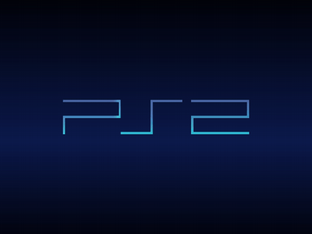
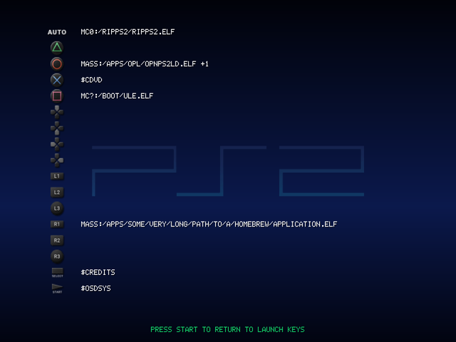
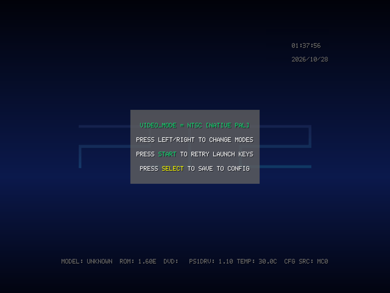
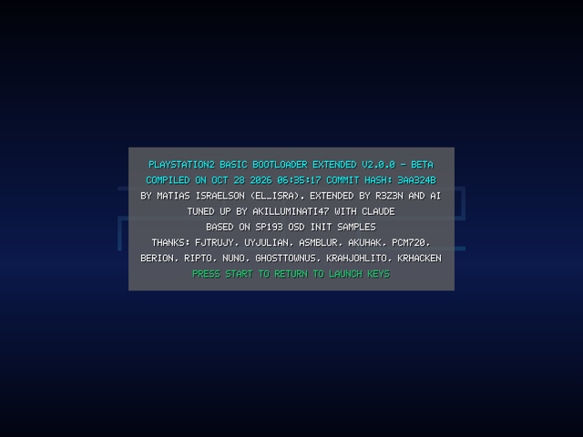

<!-- i18n: the language bar, made by ps2-pillars tools/readme-i18n -->
<p align="center">
  <a href="README.md">English</a> |
  <a href="README.es.md">Español</a> |
  <a href="README.pt-BR.md">Português (Brasil)</a> |
  <a href="README.pt.md">Português</a> |
  <a href="README.fr.md">Français</a> |
  <a href="README.de.md">Deutsch</a> |
  <a href="README.it.md">Italiano</a> |
  <a href="README.nl.md">Nederlands</a> |
  <a href="README.da.md">Dansk</a> |
  <a href="README.sv.md">Svenska</a> |
  <a href="README.pl.md">Polski</a> |
  <a href="README.cs.md">Čeština</a> |
  <a href="README.hr.md">Hrvatski</a> |
  <a href="README.sr.md">Srpski</a> |
  <a href="README.bg.md">Български</a> |
  <b>Русский</b> |
  <a href="README.el.md">Ελληνικά</a> |
  <a href="README.hu.md">Magyar</a> |
  <a href="README.ro.md">Română</a> |
  <a href="README.gl.md">Galego</a> |
  <a href="README.sq.md">Shqip</a> |
  <a href="README.tr.md">Türkçe</a> |
  <a href="README.ar.md">العربية</a> |
  <a href="README.fa.md">فارسی</a> |
  <a href="README.ja.md">日本語</a> |
  <a href="README.ko.md">한국어</a> |
  <a href="README.zh-CN.md">简体中文</a> |
  <a href="README.zh-TW.md">繁體中文</a> |
  <a href="README.vi.md">Tiếng Việt</a> |
  <a href="README.lo.md">ລາວ</a> |
  <a href="README.id.md">Bahasa Indonesia</a> |
  <a href="README.fil.md">Filipino</a> |
  <a href="README.ceb.md">Cebuano</a>
</p>
<!-- /i18n -->

<p align="center"><sub>Перевод английского README; при расхождениях верен английский. <a href="README.md">English</a></sub></p>

<p align="center"><sub><a href="https://github.com/akilluminati47/RIPPS2">RIPPS2</a> &nbsp;&middot;&nbsp; <a href="https://github.com/akilluminati47/RIPPS2/releases/latest/download/RIPPS2.elf">Скачать</a> &nbsp;&middot;&nbsp; <b>BIBLE</b> &nbsp;&middot;&nbsp; <a href="https://github.com/akilluminati47/RIPPS2-themes">Темы</a> &nbsp;&middot;&nbsp; <a href="https://github.com/akilluminati47/RIPPCSX2">RIPPCSX2</a> &nbsp;&middot;&nbsp; <a href="https://github.com/akilluminati47/RIPPS2-fonts">Шрифты</a> &nbsp;&middot;&nbsp; <a href="https://akilluminati47.github.io/RIPPS2/">Сайт</a> &nbsp;&middot;&nbsp; <a href="https://www.psx-place.com/threads/ripps2-a-ps2-front-end-in-one-elf-launch-disc-storage-memory-files.51316/">psx-place</a> &nbsp;&middot;&nbsp; <a href="https://discord.gg/Z7m9u5kby">Discord</a></sub></p>

<h1 align="center">BIBLE</h1>
<p align="center">
  <a href="https://github.com/akilluminati47/RIPPS2">RIPPS2</a> ·
  <a href="https://github.com/akilluminati47/BIBLE/actions">Сборки</a> ·
  <a href="https://github.com/saildot4k/PlayStation2-Basic-BootLoader-Extended">PS2BBL Extended</a> ·
  <a href="https://github.com/israpps/PlayStation2-Basic-BootLoader">PS2BBL</a> ·
  <a href="LICENSE">GPL-3.0</a>
</p>

<p align="center">
  
</p>
<p align="center">
  
  
  <br>
  <sub>Удерживайте L2 + R2 при запуске для страницы клавиш запуска, TRIANGLE + CROSS для страницы видеорежима; клавиша, назначенная на <code>$CREDITS</code>, показывает титры.</sub>
</p>

BIBLE — загрузчик, который устанавливает RIPPS2: форк PS2BBL Extended от saildot4k.

**Что меняет этот форк**

- Заставка: логотип PS2 по центру неба RIPPS2, кнопки под ним, любой текст над ним.
  `BIBLE_GLYPHS` 0 никаких, 1 передние кнопки (по умолчанию), 2 все шестнадцать в два ряда по восемь.
  `BIBLE_INFO` 1 показывает сведения о консоли, часы и обратный отсчёт (по умолчанию выключено).
  Небо совпадает с вашим Color Theme из RIPPS2: без `BIBLE_COLOR` BIBLE читает небо, которое RIPPS2 сохраняет со своими
  настройками, из папки RIPPS2, которую запускает его пункт AUTO (`BIBLE_COLOR` в конфигурации главнее).
  Один и тот же вид в каждом видеорежиме. Страницы (видеорежим, титры, клавиши запуска) плавно появляются поверх затемнённого логотипа
  с убранными кнопками, чтобы клавиши запуска читались спокойно.
- Видеорежимы: `VIDEO_MODE` принимает также `576P`, `720P` и `1080I`, остальные режимы RIPPS2. `AUTO` (по умолчанию)
  запускается в Video Mode из RIPPS2, если его настройки лежат рядом с пунктом AUTO, иначе в режиме самой консоли.
- `BIBLE_WIDESCREEN`: `AUTO` (по умолчанию: Widescreen из RIPPS2, иначе настройка экрана 16:9 в PS2), `ON` или
  `OFF`. В 480i, 576i, 480p и 576p заставка рисуется для телевизора, растягивающего картинку до 16:9, без
  сплющивания. 720p и 1080i уже 16:9.
- Без скачка при входе в RIPPS2: при запуске логотип и кнопки гаснут, а небо остаётся на экране в режиме RIPPS2;
  RIPPS2 стартует на том же небе. Удерживайте TRIANGLE + CROSS при запуске для страницы видеорежима, которая всегда открывается
  в собственном чересстрочном режиме консоли (путь назад из 720p или 1080i на композитном кабеле).
- Новое: страница клавиш запуска. Удерживайте L2 + R2 при запуске, чтобы прочитать путь запуска каждой клавиши, какими бы ни были настройки заставки.
- Комбинации, удерживаемые с момента включения, теперь открывают свои страницы (TRIANGLE + CROSS терялось, пока геймпады ещё
  запускались).
- `KEY_READ_WAIT_TIME = 0` разрешено (минимум в upstream — 500 мс).
- Сборки для PS2 под карту памяти / USB, MMCE, MX4SIO и HDD. Второй этап eGSM не включён.

**Как его использует RIPPS2**

RIPPS2 будет нести BIBLE в виде подписанных загрузочных файлов и устанавливать его из своих Settings (Boot Loader) вместо PS2BBL 1.2.0, который несёт сейчас. BIBLE работает и как ELF, запущенный другим загрузчиком (FMCB, OSDMenu, загрузчик SD2PSX). Выпуска BIBLE пока нет.

<p align="center"><br><sub>BIBLE входит в <a href="https://github.com/akilluminati47/RIPPS2">RIPPS2</a>.</sub></p>

---

<p align="center"><sub>Всё ниже — оригинальный README PS2BBL Extended, переведённый и в остальном без изменений.</sub></p>

---


<br />
<p align="center">
  <a href="https://israpps.github.io/PlayStation2-Basic-BootLoader/">
    
  </a>

  <p align="center">
    Гибкий загрузчик для PlayStation 2™ и PSX-DESR
    <br />
  </p>
</p>  


Это форк PS2BBL от [El Isra](https://github.com/israpps/PlayStation2-Basic-BootLoader/)


## Документация

Она размещена на [github pages](https://israpps.github.io/PlayStation2-Basic-BootLoader/), но с дополнениями ниже:

## Конфигурация и аргументы

Правьте файл конфигурации по необходимости. Для правки рекомендуется [R3Configurator](https://github.com/saildot4k/R3CONFIGURATOR). Пути уже настроены под загрузки из [PS2 Homebrew Store](https://ps2homebrewstore.com). Поэтому вам нужно будет изменить только выбор Auto и лучше задать аргументы для NHDDL под устройство, с которого вы загружаете ISO.

### Порядок поиска конфигурации

Поиск конфигурации теперь учитывает семейство загрузки, чтобы не загружать при старте лишние драйверы:

1. `CONFIG.INI` (CWD: текущая рабочая папка)
2. При загрузке с устройства:
   - Загрузка с MMCE: `mmce?:/PS2BBL/CONFIG.INI`
   - Загрузка с MX4SIO: `mx4sio:/PS2BBL/CONFIG.INI`
   - Загрузка с APA HDD: `hdd0:__sysconf:pfs:/PS2BBL/CONFIG.INI`
   - Загрузка с BDM: `usb:/PS2BBL/CONFIG.INI` / `mass:/PS2BBL/CONFIG.INI` / `ata:/PS2BBL/CONFIG.INI`
3. Запасной вариант на карте памяти:
   - На PS2: `mc?:/SYS-CONF/PS2BBL.INI`
   - На PSX-DESR: `mc?:/SYS-CONF/PSXBBL.INI`
4. Последний запасной вариант на PSX
   - `xfrom:/PS2BBL/CONFIG.INI`
5. При сборке с `DISC_STOP_AT_BOOT=1
   - `cdrom0:/PS2BBL/CONFIG.INI`
   - Запасной вариант на карте памяти, как в пункте 3 выше.

### Префиксы путей устройств
PS2BBL поддерживает такие префиксы путей запуска/конфигурации:
- `mc0:/`, `mc1:/`, `mc?:/`
- `usb:/` (предпочтительно) и `mass:/` (устаревший)

#### В зависимости от сборки:  
- `mmce0:/`, `mmce1:/`, `mmce?:/` __сборки MMCE__
- `mx4sio:/` (предпочтительно) и `massX:/` (устаревший)  __сборки MX4SIO__
- `hdd0:partition:pfs:/<path to elf>` __сборки HDD__
- Пути `xfrom:/` __сборки PSX DESR__
- `ata:/` устройство BDM для HDD с exFAT
- `ilink:/` (корни накопителей BDM) __пока не реализовано__
- `DISC_STOP_AT_BOOT=1` профиль сборки, который всегда останавливает оптический диск после загрузки конфигурации

### LOGO_DISPLAY
Используйте `LOGO_DISPLAY = 3`, чтобы показывать названия клавиш. Названия задаются через `NAME_<BUTTON>`.
  - `0` Без логотипа и сведений о консоли
  - `1` Сведения о консоли
  - `2` Логотип PS2BBLE/PSXBBLE и сведения о консоли
  - `3` Графика клавиш с `NAME_BUTTON = <TITLE>` из файла конфигурации
    - Пример:
      ```
      NAME_SQUARE = POPSLOADER
      ```

#### Свой логотип заставки из CWD
Если в CWD (текущей рабочей папке) найден свой файл логотипа (LOGO.BIN), он заменяет встроенный логотип PS2BBLE/PSXBBLE.

Преобразуйте PNG в ожидаемый сырой файл:
  - PNG должен быть RGBA, 8 бит с палитрой, 255 цветов на канал, разрешение 256x64.

  - Пакет выпуска (скрипт лежит в корне выпуска):
  ```bash
  python png_to_logo_rbga.py my_logo.png
  ```

  - Положите созданный `LOGO.BIN` рядом с PS2BBL Extended. Это должно быть `mc?:/BOOT/`, если вы используете загрузки из [PS2 Homebrew Store](https://ps2store.com)

### Визуальный ID игры от Retrogem
- `APP_GAMEID = 1` включает визуальный ID игры для приложений/homebrew, до 11 символов из имени файла или диска PS1/2
- `CDROM_DISABLE_GAMEID = 1` выключает визуальный ID игры для дисков, запущенных через `cdrom`.

### Управление вращением диска
- Глобальный ключ/значение: `DISC_STOP = 0/1`
- `DISC_STOP = 1` останавливает оптический диск после загрузки конфигурации, если найден файл конфигурации.
- `DISC_STOP = 0` (или не задано) оставляет поведение по умолчанию.
- `-disc_stop` можно добавить к каждому пункту запуска, чтобы остановить диск, когда целевой ELF найден.

### Видеорежим
- `VIDEO_MODE = AUTO, NTSC, PAL, 480P` Использует режим PS2 по умолчанию или принудительно включает один из других 3.

#### Аварийный выбор видеорежима
- Открывается сочетанием `TRIANGLE + CROSS` при запуске
- Пока выбор активен, он принудительно включает `LOGO_DISPLAY = 3`, чтобы вы видели логотип и клавиши.
- Управление:
  - `LEFT/RIGHT` переключают режимы: `AUTO`, `NTSC`, `PAL`, `480P`
  - `SELECT` сохраняет выбранный режим в активный файл конфигурации
  - `START` закрывает выбор и переходит к показу клавиш

### Аргументы запуска CDROM
Для `LK_*_E* = cdrom` поддерживаются аргументы:
- `-nologo`
- `-nogameid`
- `-ps1fast`
- `-ps1smooth`
- `-ps1vneg`
- `-gsm=<v[:c]>`

#### Аргументы PS2LOGO (только диски PS2)
- Используйте `cdrom` как путь пункта запуска.
- Добавьте `-nologo` к аргументам пункта, чтобы запускать диски PS2 напрямую (без `rom0:PS2LOGO`).
- Без `-nologo` PS2BBL запускает диск через PS2LOGO и патчит его, чтобы всегда использовать регион диска и обходить проверку контрольной суммы логотипа.
- DECKARD IE 75K и новее: XPARAM.IRX применяется автоматически, когда нужно, при запуске без логотипа.

#### Аргументы дисков PS1 (для каждого запуска)
Они действуют для каждого пункта запуска `cdrom`, а не глобально.
- `-ps1fast` включает быструю скорость диска PS1.
- `-ps1smooth` включает сглаживание текстур.
- `-ps1vneg` запускает PS1DRV через PS1VModeNegator. Полезно там, где режим консоли и режим диска различаются (например в некоторых случаях с MechaPwn/модчипами).

### Аргументы приложений
Используйте строки `ARG_<BUTTON>_E? =`, чтобы передать аргументы в ELF (см. примеры INI).
- Сначала укажите аргументы запускаемого elf, затем добавьте нужные внутренние аргументы PS2BBL (см. ниже). [NHDDL](https://github.com/pcm720/nhddl) — отличный кандидат для аргументов, ведь они ускоряют его загрузку.
- `-titleid=SLUS_123.45` заменяет ID названия приложения (до 11 символов).
- `-appid` принудительно включает визуальный ID игры приложения даже при `APP_GAMEID = 0`.
- `-disc_stop` останавливает диск после загрузки целевого ELF (полезно для пункта без сборок `DISC_STOP_AT_BOOT`).
- `-gsm=<v[:c]>` запускает целевой ELF через встроенный eGSM (игнорируется для путей `rom?:`). Если используется, должен быть последним аргументом.
- `-disc_stop` игнорируется для пунктов запуска `cdrom`.
- `-dev9=<mode>` задаёт политику DEV9/HDD перед запуском целевого ELF. Поддерживаемые режимы:
  - `NICHDD` оставляет включёнными и DEV9 (сетевой адаптер), и HDD.
  - `NIC` оставляет включёнными DEV9/сеть, отключает `pfs0:` и сразу переводит `hdd0:`/`hdd1:` в режим ожидания.
  - если не задано, PS2BBL не навязывает политику DEV9.
  - примечание: в сборках без HDD эта опция ни на что не влияет.
- `-patinfo` включает обработку PATINFO для пунктов `:PATINFO`.
  - PS2BBL читает `SYSTEM.CNF` из области атрибутов раздела (`PS2ICON3D`) и применяет `BOOT2/BOOT/path`, `arg*`, `skip_argv0` и `HDDUNITPOWER`.
  - если `BOOT2/BOOT/path=PATINFO`, PS2BBL загружает встроенный ELF из области атрибутов раздела и использует внутреннюю передачу `-la=E...`.
  - если `IOPRP=PATINFO` (или свой путь), PS2BBL передаёт его второму этапу через внутреннюю передачу `-la=I...`.
  - если указан `-patinfo`, первый оставшийся аргумент заменяет цель `BOOT2/BOOT/path` из CNF.
  Это для сборок HDD.  
  Пример PATINFO:  
    ```
    NAME_R1 = My App via PATINFO
    LK_R1_E1 = hdd0:+OSDMENU:PATINFO
    ARG_R1_E1 = pfs:/APPS/MYAPP.ELF
    ARG_R1_E1 = -patinfo               # Tells PS2BBL to use first arg as patinfo boot path.
    ```

Пример запуска NHDDL в видеорежиме 480p с поиском ISO на mmce и на HDD с exFAT без nhddl.yaml. Плюс в том, что не тратится время на загрузку драйверов, поиск и загрузку nhddl.yaml. Это самый быстрый способ запустить NHDDL и показать список ISO.
```
NAME_R1 = NHDDL
LK_R1_E1 = mmce?:/NEUTRINO/nhddl.elf
ARG_R1_E1 = -video=480p
ARG_R1_E1 = -mode=mmce
ARG_R1_E1 = -mode=ata
```

#### Приоритет и порядок аргументов
1. PS2BBL разбирает и забирает только завершающие управляющие аргументы загрузчика из `ARG_*`: `-appid`, `-titleid=`, `-dev9=`, `-patinfo`, `-disc_stop`, `-gsm=`.
2. Разбор идёт снизу вверх и останавливается на первом неуправляющем аргументе (завершающее поведение в стиле OSDMenu).
4. Для путей запуска `:PATINFO` PS2BBL разбирает `SYSTEM.CNF` из атрибута раздела и добавляет записи `arg*` из CNF после аргументов приложения пользователя.
5. Если задан `-patinfo` и путь запуска содержит `:PATINFO`, первый оставшийся аргумент пользователя становится путём целевого ELF (заменяет путь загрузки из CNF) и удаляется из argv приложения. Если аргументов не осталось, запуск прерывается (как в OSDMenu), а `BOOT2/BOOT/path` из CNF не используется.
6. Оставшиеся аргументы сохраняют порядок и передаются запущенному приложению.


### eGSM (external Graphics Synthesize Mode)
Для дисков PS2 eGSM читается автоматически из `OSDGSM.CNF` (путь в INI не нужен). Формат файла конфигурации описан [здесь](https://github.com/pcm720/OSDMenu/blob/main/patcher/README.md#osdgsmcnf).

- `-gsm=<v[:c]>` запускает целевой ELF через встроенный eGSM (игнорируется для путей `rom?:`).
  - eGSM применяется к запущенной цели (ELF/диск), а не к самому PS2BBL.
  Формат eGSM (в стиле OSDMenu):
- `v` = видеорежим:
- пусто = не навязывать (по умолчанию)
- `fp1` = принудительная прогрессивная развёртка (240p/288p)
- `fp2` = принудительная прогрессивная развёртка (480p/576p)
- `1080ix1` = принудительно 1080i, ширина/высота x1
- `1080ix2` = принудительно 1080i, ширина/высота x2
- `1080ix3` = принудительно 1080i, ширина/высота x3
- `c` = режим совместимости:
- пусто = нет (по умолчанию)
- `1` = смена полей, тип 1
- `2` = смена полей, тип 2
- `3` = смена полей, тип 3

Примеры ARG для eGSM:
- `-gsm=fp2`
- `-gsm=fp2:1`
- `-gsm=1080ix2`

Пример использования:
```
LK_TRIANGLE_E1 = mc0:/APP_WLE-ISR/WLE-ISR.ELF
ARG_TRIANGLE_E1 = -gsm=1080ix2
```

## Устарело/Удалено
- ~~`RUNKELF`~~ PS2BBLE теперь сам запускает elf/kelf, и пользователю не нужно задавать действие запуска kelf.


## Известные ошибки/проблемы

это вы мне скажите ;)

## Благодарности

- От saildot4k
  - @israpps за [PS2BBL](https://github.com/israpps/PlayStation2-Basic-BootLoader/)
  - @pcm720 за
    - gameID от Retrogem, PS1 Video Negator, eGSM и код PS2LOGO из [OSDMenu](https://github.com/pcm720/OSDMenu)
    - параметры видеорежима из [NHDDL](https://github.com/pcm720/nhddl)
  - @sp193 за [PS1 Video Negator](https://github.com/ps2homebrew/PS1VModeNeg)
  - @nathanneurotic за 10 путей PS2BBLE, идеи и уговоры
  - [@Berion](https://www.psx-place.com/members/berion.1431/) за логотипы, фон и графику клавиш

- От [El Isra](https://israpps.github.io/) (разработчик PS2BBL): 
  - @SP193 за библиотеки инициализации OSD, на которых построен этот проект
  - @asmblur за то, что вдохновил меня сделать этого монстра на последнем SDK
  - @uyjulian и @fjtrujy за то, что всегда мне помогают


<p align="center"><sub><a href="https://github.com/akilluminati47/RIPPS2">RIPPS2</a> &nbsp;&middot;&nbsp; <a href="https://github.com/akilluminati47/RIPPS2/releases/latest/download/RIPPS2.elf">Скачать</a> &nbsp;&middot;&nbsp; <b>BIBLE</b> &nbsp;&middot;&nbsp; <a href="https://github.com/akilluminati47/RIPPS2-themes">Темы</a> &nbsp;&middot;&nbsp; <a href="https://github.com/akilluminati47/RIPPCSX2">RIPPCSX2</a> &nbsp;&middot;&nbsp; <a href="https://github.com/akilluminati47/RIPPS2-fonts">Шрифты</a> &nbsp;&middot;&nbsp; <a href="https://akilluminati47.github.io/RIPPS2/">Сайт</a> &nbsp;&middot;&nbsp; <a href="https://www.psx-place.com/threads/ripps2-a-ps2-front-end-in-one-elf-launch-disc-storage-memory-files.51316/">psx-place</a> &nbsp;&middot;&nbsp; <a href="https://discord.gg/Z7m9u5kby">Discord</a></sub></p>

